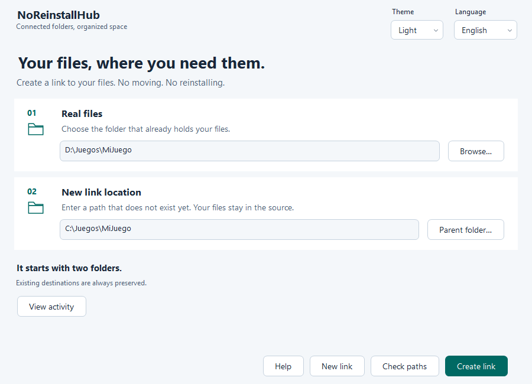
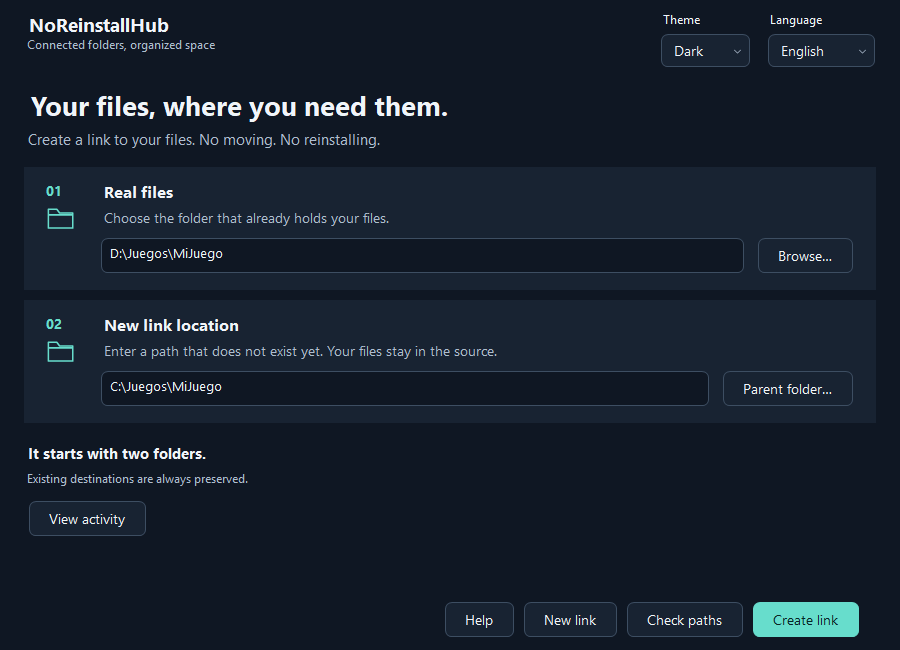

# NoReinstallHub 1.1.2

Connect two folder locations without moving your files. NoReinstallHub creates an **NTFS junction** at a new path that points to the folder that already contains your data.

A native desktop app built with **C#, Windows Forms, and Microsoft .NET 8**. No accounts, ads, services, or telemetry. It does not move, copy, or delete your data.

## The interface

The two numbered cards distinguish **Real files** from **New link location**. The primary action creates the link; **Check** validates the paths without changing anything. Results appear in the window, with actions to open the destination or copy its path. Session activity can be expanded when needed.

Choose light, dark, or system theme, and English, Spanish, Portuguese, or French. On first launch, choose your language and appearance. Only these preferences are saved; paths and activity stay in memory.

The 1.1.2 screenshots below use example paths. They show the app client area and do not create any links.

### Light theme



### Dark theme



## Download

Get published builds from [GitHub Releases](https://github.com/AIMDYCK/NoReinstallHub/releases). For the framework-dependent build, extract the complete ZIP and keep its files together. The .NET Desktop Runtime 8 is required.

## Requirements and local build

Windows 10/11, a local NTFS volume for the link, and **.NET Desktop Runtime 8** for the framework-dependent build. Building requires the .NET SDK and .NET 8 reference packs. The project remains on `net8.0-windows`; it was verified using SDK 10.0.404.

There are no external NuGet packages. NoReinstallHub runs with the current user's permissions; it does not require administrator rights or open a command window. Choose locations where you have write access. Protected folders may be rejected by Windows.

To create a local portable folder after verification:

```powershell
dotnet publish NoReinstallHub.csproj -c Release --no-restore --self-contained false -o artifacts/portable
```

Run `artifacts\portable\NoReinstallHub.exe` and keep the whole folder together. This distribution requires the runtime to be installed; it is not a single-file executable.

## How to use

1. On first launch, choose a theme and language, then select **Get started**.
2. Under **Real files**, choose the folder that already contains your data.
3. Under **New link location**, enter a new path. **Parent folder** suggests an editable name.
4. Select **Check** to validate without changes, then **Create link**.
5. After success, open the destination, copy its path, or prepare another link.

Example: source `D:\Games\MyGame`, link `C:\Games\MyGame`. Both paths open the same data. The app does not move an existing installation first; if you need to move data, prepare and verify that copy separately.

The destination must not exist, even if it is empty. Nothing is replaced or deleted. To prevent cycles and aliases, the app rejects identical or nested paths, drive roots, network paths, reserved names, and paths that pass through another link. Valid characters such as `&`, `%`, `!`, and `^` are handled literally; no command interpreter is used.

Close apps that use these folders and keep a backup. Editing through the link changes the real files. Avoid system folders and folders used by running applications.

Shortcuts: **Alt+1** source, **Alt+2** destination, **Ctrl+Enter** create, **F1** help. Tab moves between controls and keyboard focus stays visible. The content scrolls while actions remain available on small screens.

## Build and tests

Clone the repository:

```powershell
git clone https://github.com/AIMDYCK/NoReinstallHub.git
Set-Location NoReinstallHub
```

Run the complete verification:

```powershell
pwsh -NoProfile -File scripts/Verificar.ps1
```

It cleans known Debug/Release outputs, restores using the local NuGet configuration, builds both configurations with warnings as errors, runs the native test runner, and queries outdated and vulnerable packages.

The test runner is a standalone executable; **dotnet test does not run it**. Tests briefly show windows and save images under artifacts/. They cover path safety, data preservation, concurrent creation, preferences, translations, contrast, and a simulated 100/125/150/200% scaling matrix. Simulation does not replace testing on real DPI monitors or with screen readers.

To regenerate the README screenshots after building the tests, run: `dotnet run --project tests/NoReinstallHub.Tests/NoReinstallHub.Tests.csproj -c Release --no-build --no-restore -- --capture-docs`. It uses example paths and also keeps `docs/screenshot.png` for older links. For a quicker check without the visual matrix, run `pwsh -NoProfile -File scripts/Verificar.ps1 -SkipVisual`.

## Errors and recovery

Errors are shown in the selected language. Check permissions, volume availability, and that the destination is still free. The app never requests elevation automatically.

If Windows rejects conversion of the newly created directory into a junction, an empty folder created by the app may remain. It is not deleted automatically; check the destination before trying again. Native operations cannot be cancelled midway through a write, so wait for them to finish before closing the app.

Preferences are stored at `%LOCALAPPDATA%\NoReinstallHub\preferences.json`. If the file is unreadable or malformed, it is preserved and safe defaults are used for that session.

## Privacy and license

See [Privacy](PRIVACIDAD.md) for details. NoReinstallHub is licensed under **MIT**; see [LICENSE](LICENSE).
